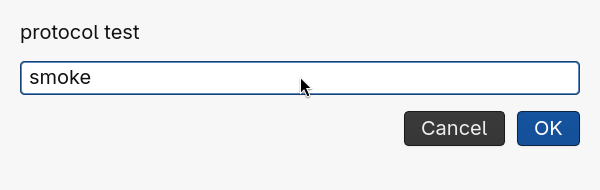

# Native desktop text entry

The Linux/Wine implementation provides `XGameUiShowTextEntryAsync` and its result
APIs through a separate GTK4 window. This avoids focused Win32 edit controls
blackening inside the Forza Horizon 6 game process under Hyprland/XWayland.
The helper uses a physical keyboard: Enter submits and Escape/Cancel dismisses.
It is not a controller-operated onscreen keyboard.

The component installs `nexus-text-entry.py` and its matching
`nexus-text-entry-host.exe` bridge alongside the DLL. Runtime assembly stages
both files into the default prefix; Proton refreshes them in existing prefixes
as well. WOW64 uses the matching 32-bit bridge in `windows/syswow64`.
The bridge resolves the Python helper through Wine's `wine_get_unix_file_name`,
so prefixes and runtime installations may be relocated or contain spaces.
Host Python 3, PyGObject and GTK4 are required. Other platforms or missing host
components report failure rather than fabricate a successful text result.

Requests use a single-use authenticated loopback connection on an OS-assigned
port. All game strings travel in that connection, never command arguments,
files or diagnostics. Only the loopback port appears in process arguments. The DLL passes the random
one-use token to the dedicated PE bridge through a private inherited stdin pipe,
with an explicit inherited-handle allowlist. The bridge sets that token in its
own Unix child environment before starting Python; the game's environment is
not modified. This avoids Wine's `start.exe` environment/stdio handoff, which
dropped the private token during exact-build validation. Python removes the
token before loading GTK. The helper cleans inherited Proton GLib/GIO library paths
before starting the host GTK process. Cancellation and game disconnection close
the dialog. All lengths are bounded; requests over 2,097,152 characters are
rejected. Password requests use the GDK default 1024-character limit.

`Number` input scope accepts ASCII digits; other ordinary scopes retain general
text input. UTF-8 result lengths include the terminator. Character limits count
Unicode characters rather than bytes or UTF-16 surrogate units. Empty text is a
successful result; cancellation is `HRESULT_FROM_WIN32(ERROR_CANCELLED)`.

Some games request generic text even for numeric-looking identifiers. The shared
implementation does not infer a numeric type from an English label or title.
A tested local FH6 workaround for its `Default`/10-character share-code request
is intentionally outside this generic proposal pending maintainer direction.

On Hyprland, users who enable pointer-driven focus may choose this narrow rule
in their own configuration (not a package installation side effect):

```lua
o.window({ class = "^io.github.nexus.TextEntry$" }, {
  float = true,
  center = true,
  stay_focused = true,
  no_follow_mouse = true,
  opaque = true,
})
```

Source-independent protocol/model tests need no GTK or display:

```sh
python3 -m unittest discover -s tests/TextEntry -v
```

Isolated helper display check, using synthetic test text:



## Reproducible transport validation

Configure the component with `-DNEXUS_NATIVE_TEXT_ENTRY_PROBE=ON`, then build
`xgameruntime`, `nexus-text-entry-host` and `nexus_text-entry-probe` and install
into a private staging directory. With the matching Wine/Proton runtime:

```sh
python3 tests/TextEntry/run_transport_probe.py \
  --runtime /path/to/matching-runtime --stage /path/to/component-stage \
  --probe /path/to/build/bin/nexus_text-entry-probe.exe --arch x86_64
```

Use the 32-bit build/stage and `--arch i386` for WOW64. The runner makes a private
runtime copy and an unauthenticated prefix with spaces in its path. It exercises
the compiled GDK async/results API, real PE bridge and authenticated loopback,
including rejection of an unauthenticated client before any request text is
sent. Its synthetic UI uses the production parser and sanitizer. Eleven cases
cover UTF-8 results, Unicode limits, Number scope, general text, password limits,
empty input, insufficient result buffers, Cancel and asynchronous cancellation.
This is transport/ABI validation, not a GTK display or gameplay test. A separate
live-game check is still needed for focus, rendering and text submission.
